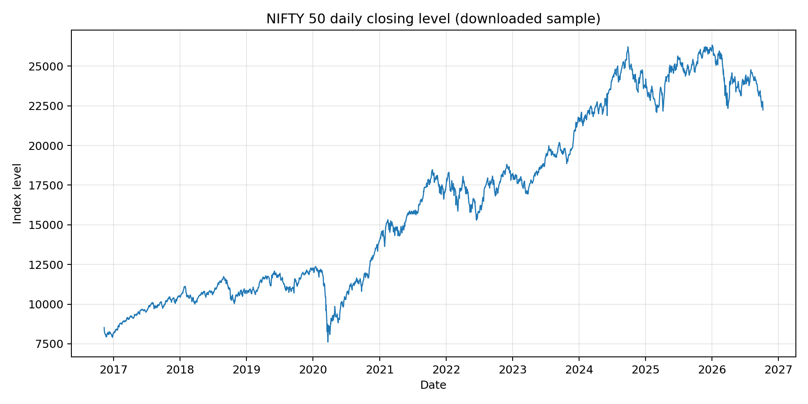
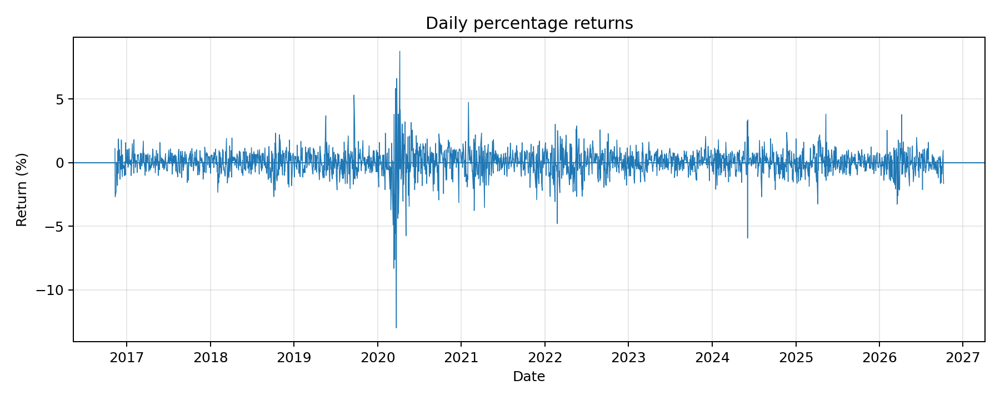
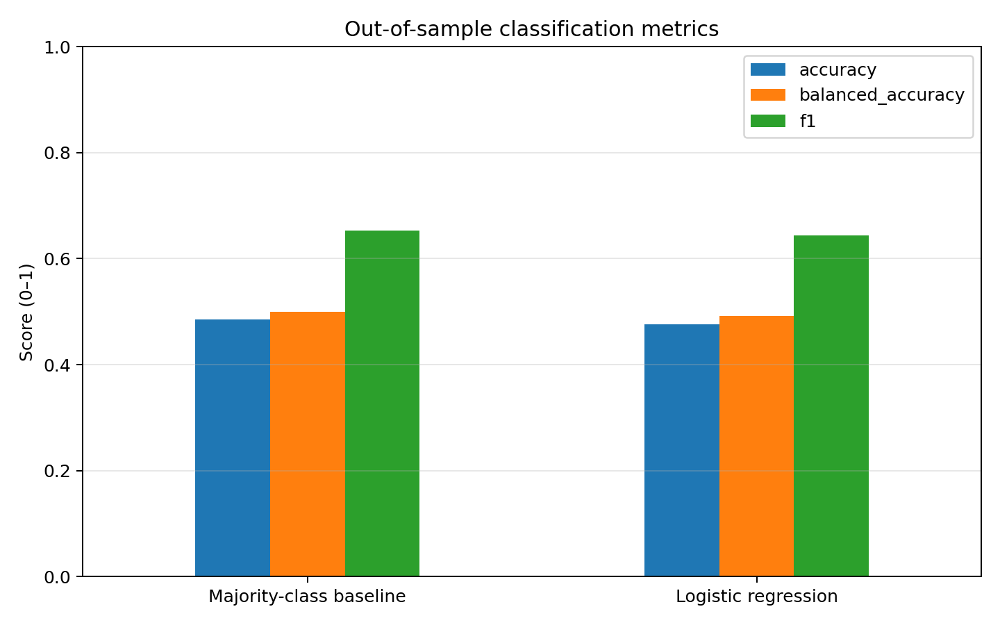
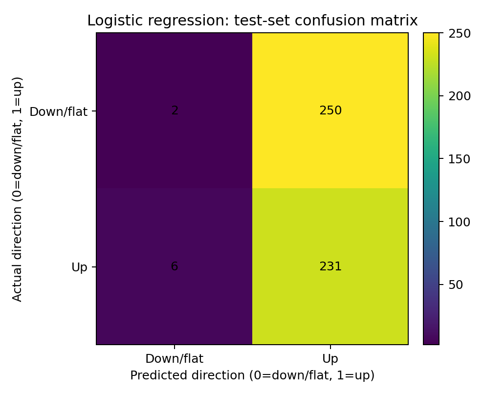
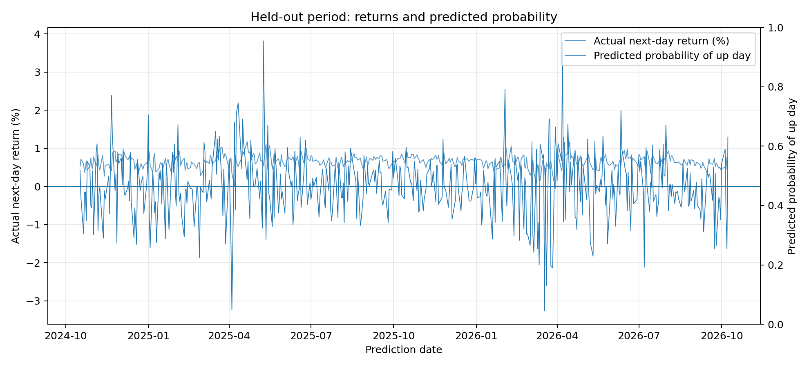

# Can Simple Mathematical Models Predict Next-Day Stock Market Direction?

A quantitative finance research project investigating whether simple historical price features can predict the next observed trading-day direction of the NIFTY 50 index.

## Research Question

Can logistic regression predict whether the next observed NIFTY 50 daily return will be positive, and does it outperform a majority-class baseline on unseen data?

## Project Overview

This project uses historical NIFTY 50 index prices to build and evaluate a basic machine-learning classification model.

The experiment compares:

- **Majority-class baseline:** predicts the most frequent target class in the training data.
- **Logistic regression:** uses historical return, rolling volatility, and moving-average features to predict the next observed trading-day direction.

The goal is to investigate predictive performance using a reproducible experiment, not to develop a profitable trading strategy.

## Data

- **Index:** NIFTY 50
- **Ticker:** `^NSEI`
- **Source:** Yahoo Finance, accessed through `yfinance`
- **Frequency:** Daily
- **Observed period:** 10 October 2016 – 9 October 2026
- **Price observations:** 2,466
- **Usable feature/target observations:** 2,445

The dataset and run metadata are included in the repository so the analysis can be inspected.

## Methodology

The target is 1 if the next observed close-to-close daily return is positive, and 0 otherwise.

Features include:

1. Current daily return
2. Previous daily return
3. Five-day mean return
4. Twenty-day rolling volatility
5. Price gap from the five-day moving average
6. Price gap from the twenty-day moving average

The observations are ordered chronologically. The earliest 80% are used for training, while the later 20% form the held-out test set. Feature scaling is fitted on the training data only.

## Results

| Metric | Majority-class baseline | Logistic regression |
|---|---:|---:|
| Accuracy | 48.47% | 47.65% |
| Balanced accuracy | 50.00% | 49.13% |
| F1 score | 0.6529 | 0.6435 |
| ROC AUC | Not defined | 0.4904 |

Logistic regression did not outperform the majority-class baseline in accuracy on this held-out period. The results do not establish reliable predictive ability or profitability.

See [`research_report.md`](research_report.md) for the complete analysis and limitations.

## Visual Results

### NIFTY 50 Price History



### Daily Returns



### Model Comparison



### Confusion Matrix



### Held-Out Predictions



## Repository Structure

```text
nifty50-direction-prediction/
├── README.md
├── quant_finance_experiment.py
├── quant_finance_research_complete.ipynb
├── requirements.txt
├── research_report.md
├── data/
│   ├── nifty50_daily_prices.csv
│   └── modeling_dataset.csv
├── results/
│   ├── model_metrics.csv
│   ├── test_predictions.csv
│   └── run_metadata.json
└── figures/
    ├── price_history.png
    ├── daily_returns.png
    ├── model_comparison.png
    ├── confusion_matrix.png
    └── test_predictions.png
```

## How to Reproduce

### Option 1: Google Colab

1. Open the notebook in Google Colab.
2. Run the cells in order.
3. Allow internet access for downloading the historical data.
4. Inspect the metrics, saved files, and generated graphs.

### Option 2: Run Locally

Install the dependencies:

```bash
pip install -r requirements.txt
```

Run the experiment:

```bash
python quant_finance_experiment.py
```

A fresh run may produce slightly different data or results because the data source can change.

## Limitations

- The experiment uses one chronological train/test split.
- Market returns are noisy, and historical relationships may not persist.
- Results may be sensitive to the test period.
- Transaction costs, slippage, and trading risk are not modeled.
- This experiment does not establish a profitable investment strategy.

## Future Work

- Evaluate performance using walk-forward validation.
- Investigate why the model predicts the upward class so frequently.
- Compare carefully selected alternative models.
- Examine probability calibration and class-specific performance.
- Test whether any improvements persist across multiple unseen periods.

## References

- Yahoo Finance data access: https://github.com/ranaroussi/yfinance
- Scikit-learn Logistic Regression: https://scikit-learn.org/stable/modules/generated/sklearn.linear_model.LogisticRegression.html
- Scikit-learn model evaluation: https://scikit-learn.org/stable/modules/model_evaluation.html
- Fama, E. F. (1970). “Efficient Capital Markets: A Review of Theory and Empirical Work.” *The Journal of Finance*, 25(2), 383–417.

---

**Disclaimer:** This project is for educational and research purposes only. It is not financial advice.
